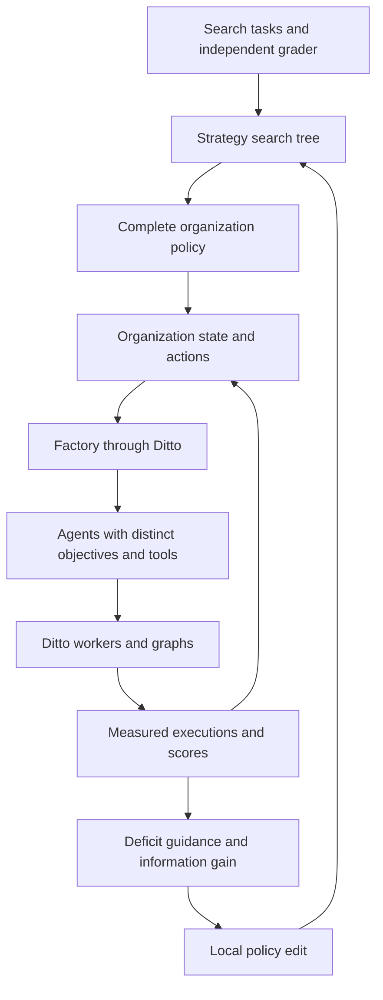

# Legacy DSL/MIA architecture

This document records the original implementation of the [research proposal](research-proposal.md). It describes explicit `legacy-search`, not the current default. Current search uses the [native AFlow controller](search-v4.md), [Ditto graph/loop programs](search-v6.md), and [single-root dynamic MAS search](dynamic-tools-and-topologies.md).

## Ownership boundary

The historical integration used registry-published Ditto 0.1.1; current package requirements are documented separately. No executable Ditto checkout, private module, linked dependency, or runtime patch is allowed.

MFlow owns datasets/graders, the policy DSL, mutation/MIA, organization state, profiles, evidence routing, and search records. Ditto owns Context/Infer/Interaction workers, graph scheduling, reasoning, tool execution, and provider protocols.

## Data and scoring

`src/data.ts` validates JSONL schemas. Custom preparation groups related tasks before seeded partitioning and records content hashes. Fixed public benchmarks preserve locked AFlow validation/test membership as search/test, without a new confirmation split. Semantic near-duplicates cannot generally be detected automatically; dataset authors must group related originals, variants, and templates.

Actors receive public task input; references remain with evaluators. Exact/numeric, mathematical-equivalence, or isolated code graders produce outcomes. Historical MIA uses binary success. DROP also records maximum token F1, but only F1=1 counts as a binary posterior success.

Repeatedly used confirmation data is selection data, not unbiased test. Evaluation checks task IDs, normalized prompt hashes, and groups against selection provenance. The five exact AFlow DROP overlap pairs are disclosed exceptions; other overlaps are rejected.

## Policy and parent selection

`src/policy.ts` implements ordered status/guard/action rules. Open-ended semantic objectives and tool descriptions remain outside the mutation grammar. Root begins with CONTINUE/STOP; REVIEW, CHALLENGE, and derive-deliver-integrate operations are searchable. Edits include guards, priorities, action changes, reuse order, depth guards, and rule removal.

Parents come from fully evaluated candidates, using top-k softmax utility mixed with uniform exploration. An infeasible root may remain an exploration origin, but an infeasible policy cannot become the exported best artifact. Budget settings are not mutable policy parameters.

Parent traces guide legal edits through discrete deficit states. ACTIVE plus artifact readiness corresponds to unrouted evidence; DELIVERED means the owner has received evidence without resolving the deficit. RESOLVED/overactive cases suggest dormancy or stopping. Runtime agents and edges do not receive invented quality scores.

## Posterior and acquisition

`src/mia.ts` accumulates real paired correction/neutral/harm counts with Dirichlet(1,1,1) priors, grouped by edit family, status, and description. Pooling across parents assumes exchangeability within a stratum; it does not prove identical effects across parent policies.

Trigger rate is the fraction of parent traces whose decision changes. Posterior samples identify the best edit in each possible world. Reweighting those worlds by hypothetical outcome likelihood estimates the reduction in entropy of the best-edit identity. Bootstrap favors low observation counts and broad coverage before acquisition dominates. Inherited results never count as fresh observations. An LLM-guided control chooses only legal edit IDs and does not replace the grader.

## Affected tasks and reuse

Traces retain complete pre-action policy inputs. Replaying a child policy identifies its first decision divergence. A task without divergence inherits the parent's observed trajectory and score, with `inheritedFrom` recorded and zero new execution cost. This is fixed-sample reuse, not a guarantee that stochastic rollouts have identical distributions.

Optional prefix reuse restores a checkpoint before the first divergence. Public Ditto `checkpointState/restoreState` stores explicit application state: population, episode/inbox/output state, deficits, artifacts, edges, retrieval records, trace, logical cost, and next decision. All prior worker calls must have completed. Restoration checks task/model/budget/pool/resource/runtime identities and earlier decisions; it does not serialize live workers or generators.

Optional agent-turn caching uses public BranchStore, complete state/model/resource keys, and a 256-entry FIFO bound. Only successful complete turns are cached; factory/retrieval calls are not. Replayed logical cost still counts toward episode feasibility while actual cost counts only new calls. Legacy checkpoint/cache support is restricted to isolated pure arithmetic; undeclared external side effects fail closed. Report cache settings and include uncached controls for stochastic comparisons.

## Progressive evaluation and promotion

Affected tasks are deterministically shuffled and evaluated in expanding batches. A non-final batch with at least three net harms can be rejected early. This is a resource-allocation heuristic, not a significance test; partial evaluation cannot promote a candidate.

After complete affected-set evaluation, inherited outcomes form the full score. Promotion requires improvement over the parent and incumbent, resource feasibility, and—when configured—complete confirmation with no degradation from the incumbent. Interrupted candidates retain observations and costs but receive no complete utility or promotion. Infrastructure/schema faults are preserved as faults rather than correctness observations.

## Agents, routing, and lifecycle

The historical `src/ditto.ts` builds an isolated Ditto runtime for each agent turn. Tool-free agents use Context/Infer graph execution; tool-enabled agents use public ReAct flow under an explicit tool manifest. Profiles distinguish reasoning, private context, objectives, and permissions.

DERIVE invokes the factory through Ditto and constructs its returned profile. REACTIVATE uses a frozen or task-local dormant member. Retrieval is relevant/not-relevant classification, not continuous value scoring. CONNECT routes the requested artifact to its owner rather than exposing an entire private context. A child cannot close the owner's deficit; the owner must execute and confirm resolution. DISCONNECT changes future routing without retracting delivered evidence.

Standard tasks start from the same fixed pool and reset episode state. Explicit continual inference/evaluation uses `src/canonical.ts` to consolidate procedural memory through Ditto, committing profiles, at most 4,000 memory characters per agent, provenance, and usage atomically in a BranchStore branch. Existing profiles remain defined; memory is injected into the next task rather than repeatedly appended. Invalid IDs or failed consolidation discard the branch. State snapshots bind to the frozen bundle and use atomic file replacement. No evaluator labels enter consolidation.

External databases/files/sessions still require general-purpose transaction support. Record package gaps in [Ditto requirements](ditto-requirements.md); do not recreate the infrastructure here. Standard search does not change the initial pool when promoting candidates.

## Accounting and stopping

Ditto TokenBudget is the reservation/settlement implementation. One request reserves against both search and episode scopes and settles the same usage. Factory, retrieval, optimization, actor, and consolidation calls carry run/branch labels. Missing usage retains conservative reservations and is reported as unknown.

The default request bound—serialized UTF-8 bytes plus output allowance and overhead—is heuristic, especially for hidden reasoning tokens. A verified provider-specific estimator may be injected. Over-reservation violations close the budget and fail the run. Replayed logical cost must not be added again to actual usage. Parallel episodes require separate mutable scopes.

Legacy stopping includes configured iterations/budgets, grammar exhaustion, or local information saturation after bootstrap and stable utility. Local low information gain cannot establish global convergence while unexplored parents remain. Save the tree, executions, decisions, posterior, usage, utility curve, and frozen bundle. The legacy search refuses existing output directories and lacks in-place search resume; the later default native path supports resume.
