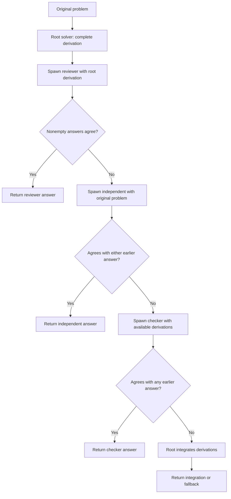

# MFlow v8 Round 2: prompt provenance, subagents, and dynamic MAS

Historical report dated 2026-09-30 (Asia/Shanghai), based on the frozen search artifact and completed executions. This report does not feed test data into search or modify a candidate.

## Artifact and selection

- Search selected Round 2 / s2. All five complete validation passes scored 117/119 (98.32%).
- Final test scored 469/486 (96.50%) using repaired runtime v3.3.1. Validation used v3.2 and was not rerun.
- Strategy SHA-256: `3d6ba55130cb5c33b80f2f88dc0d33265509067b4e2caf92fb0f381dc45c1e69`.
- [Selected strategy JSON](math-v8-round2-strategy.json) exactly preserves the frozen bundle's strategy: prompts, initial member, templates, internal programs, and MAS composition.
- [Rounds 1–9](math-v8-search-candidates.json) retain complete candidate structures. Round 9 was incomplete and Round 6 encountered a native REFLECT contract failure; neither is a validated recommendation.
- Original bundle: `runs/math-v8-round2-test-repaired-20260930-02/best.json`.
- The compatibility `rules:[unused/STOP]` does not control this candidate. Its `composition` returns the actual Ditto loop.

## AFlow prompt reuse

The source was AFlow's `workspace/MATH/workflows/round_12/prompt.py`, with its same-round `graph.py` workflow.

1. `SOLVE_PROMPT` became `prompts.agent`: stepwise derivation and a concise final boxed answer in the required format.
2. `VERIFY_PROMPT` became `prompts.review`: inspect the original problem and complete initial derivation, correct or confirm it, and return a boxed answer.
3. MFlow added a stopping instruction: check consequential steps once, explain concrete obstacles, and avoid repeated recalculation.
4. `integrate`, `factory`, `retrieve`, member profiles, and dynamic spawning were MFlow seed/search artifacts, not those two AFlow prompts.

Requests additionally contain the problem, explicitly routed evidence, objectives, capabilities, reasoning/output contracts, stopping instructions, and private context. This is prompt-text transfer, not a copy of the entire AFlow request. AFlow's selected workflow always solves then revises; MFlow retains that initial path and conditionally adds members.

Round 2 inherited all five global prompts and the solver/reviewer/independent templates unchanged from Round 1. Its addition was the checker template and routing. Do not attribute the entire library to Round 2 optimization.

## Recommended structure and conditions



Each task initializes only root, bound to solver. Every later member is spawned with root as parent and becomes dormant after its turn; saved evidence remains available. Independent initially sees neither earlier answer nor derivation. Checker sees available full derivations and focuses on original constraints.

`answerKey` extracts the boxed answer and removes whitespace for string comparison. It does not use a mathematical grader or reference answer. Equivalent expressions may disagree as strings; shared wrong answers can still stop early.

With no nonempty answers, return empty text; with one, return it. Multiple unresolved answers trigger root integration. Empty integration falls back in checker → reviewer → independent → original-root order.

This selected program is serial with conditional escalation. It contains no parallel debate, node-level cross-agent interleaving, recursive subproblem generation, or runtime profile revision. The program/templates are frozen; realized membership and route depend on the task outputs.

## Observed test paths

| Path | Tasks |
| --- | ---: |
| root → reviewer | 458 |
| root → reviewer → independent | 17 |
| root → reviewer → independent → checker | 11 |

Root and reviewer each ran on 486 tasks, independent on 28, and checker on 11. Final root integration never triggered in this test. There were 130 tool execution/observation events: nine arithmetic and 121 Python, including recoverable failures. These counts establish usage, not each member's causal accuracy contribution.

## Member capabilities

| Template / instance | Origin | Reasoning and tools | Internal program |
| --- | --- | --- | --- |
| solver / root | Round 1 seed, inherited | cot; no tools | CONTEXT.LOAD → SAMPLE |
| reviewer | Round 1 seed, inherited | cot; no tools | SAMPLE on problem and initial derivation |
| independent | Round 1 seed, inherited | react; arithmetic/Python | LOAD → SAMPLE → optional TOOL → OBSERVE → repeat |
| checker | Added in Round 2 | react; arithmetic/Python | Separate check loop with the same node categories |

Solver and independent share template code but differ in profile, permissions, and evidence. Checker uses its own objective/private method instructions. cot/react are profile descriptions; the programs below control actual execution. This candidate did not discover a distinct complex topology for every member.

Model and tool execution used public `@codesoul-co/ditto@0.1.1` and DeepSeek Flash. `spawnTemplate` creates/binds a profile; the subsequent `runAgent` nodes execute it. This selected policy did not invoke factory/retrieve, generate fresh profiles per task, or register persistent shared tools. Isolated Python execution is not evidence of creating a new reusable tool.

## Complete MAS composition (frozen text)

```javascript
function solution(output){
  return output.artifacts.filter(a=>a.type==='solution').map(a=>a.content).join('\n');
}
return loop({id:'adaptive-mas',plan:function*(ctx){
  const first=yield* ctx.runAgent('root','','agent');
  ctx.spawnTemplate('reviewer','reviewer','root');
  const review=yield* ctx.runAgent('reviewer','Initial solution:\n'+solution(first),'review');
  ctx.dormant('reviewer');
  const a=ctx.answerKey(first.candidate_answer),b=ctx.answerKey(review.candidate_answer);
  if(a && b && a===b) return review.candidate_answer;
  // Disagreement or missing answer: run an independent derivation.
  ctx.spawnTemplate('independent','independent','root');
  const independent=yield* ctx.runAgent('independent','Solve independently; verify consequential calculations with available tools when useful.','agent');
  ctx.dormant('independent');
  const c=ctx.answerKey(independent.candidate_answer);
  if(c && (c===a || c===b)) return independent.candidate_answer;
  // Still unresolved: a checker re-examines the problem statement and constraints.
  ctx.spawnTemplate('checker','checker','root');
  const check=yield* ctx.runAgent('checker',[first,review,independent].filter(x=>x.candidate_answer).map((x,i)=>'Derivation '+(i+1)+':\n'+solution(x)).join('\n\n'),'review');
  ctx.dormant('checker');
  const d=ctx.answerKey(check.candidate_answer);
  if(d && (d===a || d===b || d===c)) return check.candidate_answer;
  const complete=[first,review,independent,check].filter(x=>x.candidate_answer);
  if(!complete.length) return '';
  if(complete.length===1) return complete[0].candidate_answer;
  const final=yield* ctx.runAgent('root',complete.map((x,i)=>'Derivation '+(i+1)+':\n'+solution(x)).join('\n\n'),'integrate');
  return final.candidate_answer || check.candidate_answer || review.candidate_answer || independent.candidate_answer || first.candidate_answer;
}});
```

## All prompts (frozen text)

### agent

```text
Solve the following math problem step by step. Provide a clear, detailed reasoning process and end with the final answer in the format: \boxed{answer}. Ensure the answer is concise and matches the expected format (e.g., a number, a fraction, or a list of letters separated by commas).

Problem:
```

### factory

```text
Design one autonomous agent to resolve the supplied concrete deficit. Use the original task and the parent's evidence to identify a useful, distinct method: an independent derivation, constraint check, counterexample, decomposition, or available computation as appropriate. Choose the capability and objective for this task; there is no fixed role catalogue.
Describe the specific evidence to return to the owner in expected_output and the condition that finishes this assignment. The original task is supplied separately at execution: private_context should contain only additional method guidance, not a copy of the task or parent solution. Keep each profile field brief. Prefer independent computation, explicit exhaustive cases, or checking constraints over repeating an assertion. Do not assume the parent answer is correct.
Select tools only from available_tools; use react reasoning when choosing tools. Do not promise unavailable execution or access. Use the supplied id. Return no confidence, utility or information-gain scores.
```

### review

```text
You are given a math problem and an initial solution. Carefully review the initial solution for any errors in reasoning, calculation, or interpretation. If you find mistakes, correct them and provide the correct final answer. If the initial solution is correct, confirm it and restate the final answer. Always end with the final answer in the format: \boxed{answer}. Ensure the answer is concise and matches the expected format (e.g., a number, a fraction, or a list of letters separated by commas).

Check each consequential step once. Once the answer is established, finish the response; do not repeatedly re-derive or recheck it. If an approach stalls, state the concrete obstacle instead of cycling through the same calculations.

Problem and Initial Solution:
```

### integrate

```text
Solve the original math problem using the supplied full derivations as evidence. Identify the exact step behind any disagreement; check it by calculation or a different argument. Correct unsupported assertions rather than voting on wording. Return a self-contained solution ending with \boxed{answer}. Do not replace the stated problem with a remembered variant.

Problem:
```

### retrieve

```text
Choose a relevant reusable agent program and assign a concrete mathematical objective and method. Do not choose by a confidence score.
```

## Initial root profile (frozen text)

```json
{
  "id": "root",
  "objective": "Solve the task and integrate relevant evidence.",
  "capability": "General task reasoning and evidence integration",
  "private_context": "",
  "tools": [],
  "nodes": [
    "CONTEXT.LOAD",
    "INFER.REASONING.SAMPLE"
  ],
  "reasoning": "cot",
  "expected_output": "Complete mathematical solution ending in a boxed final answer.",
  "stop_condition": "A complete solution or a concrete unresolved obstacle is stated."
}
```

## Template: solver (frozen text)

Full mathematical derivation with context and sampling nodes.

### Profile

```json
{
  "objective": "Solve the task and integrate relevant evidence.",
  "capability": "General task reasoning and evidence integration",
  "private_context": "",
  "tools": [],
  "nodes": [
    "CONTEXT.LOAD",
    "INFER.REASONING.SAMPLE"
  ],
  "reasoning": "cot",
  "expected_output": "Complete mathematical solution ending in a boxed final answer.",
  "stop_condition": "A complete solution or a concrete unresolved obstacle is stated."
}
```

### Internal graph/loop

```javascript
return loop({id:'solve',plan:function*(ctx){
  const id=ctx.self, messages=ctx.textMessages(id,ctx.evidence,ctx.prompt);
  for(;;){
    const load=id+'/context',sample=id+'/sample';
    const g=graph(id+'/solve')
      .node(load,'CONTEXT.LOAD',[],()=>({sources:messages}))
      .node(sample,'INFER.REASONING.SAMPLE',[load],(_,out)=>ctx.request(id,
        out[load].items.map((item,i)=>({...messages[i],content:item.content})),true,'text'));
    const out=yield* graphStep(g,null);
    if(out[sample].status!=='success') return ctx.failedAgent(id,out[sample].error);
    const response=ctx.unwrap(out[sample]);
    if(!response.actionRequests?.length) return ctx.publishText(id,response.message.content);
    messages.push({...response.message,metadata:{actionRequests:response.actionRequests}});
    for(const call of response.actionRequests){
      const act=id+'/tool',observe=id+'/observe';
      const tools=graph(id+'/tools')
        .node(act,'INTERACTION.ACT.TOOL',[],()=>({call}))
        .node(observe,'INTERACTION.OBSERVE',[act],(_,out)=>({result:out[act]}));
      const result=yield* graphStep(tools,null);
      messages.push({role:'tool',content:result[observe].message.content,metadata:{actionRequestId:call.id,name:call.name}});
    }
  }
}});
```

## Template: reviewer (frozen text)

Review a complete derivation against the original problem and revise it.

### Profile

```json
{
  "objective": "Find and correct concrete errors in the supplied derivation.",
  "capability": "Mathematical review and revision",
  "private_context": "",
  "tools": [],
  "nodes": [
    "INFER.REASONING.SAMPLE"
  ],
  "reasoning": "cot",
  "expected_output": "Complete mathematical solution ending in a boxed final answer.",
  "stop_condition": "A complete solution or a concrete unresolved obstacle is stated."
}
```

### Internal graph/loop

```javascript
return loop({id:'revise',plan:function*(ctx){
  const id=ctx.self,node=id+'/revise';
  const g=graph(id+'/revise').node(node,'INFER.REASONING.SAMPLE',[],()=>
    ctx.request(id,ctx.textMessages(id,ctx.evidence,ctx.prompt),false,'text'));
  const out=yield* graphStep(g,null);
  if(out[node].status!=='success') return ctx.failedAgent(id,out[node].error);
  return ctx.publishText(id,ctx.unwrap(out[node]).message.content);
}});
```

## Template: independent (frozen text)

Independent derivation with optional exact computation, enumeration or counterexample tools.

### Profile

```json
{
  "objective": "Derive a solution independently using a complementary method.",
  "capability": "Independent mathematical reasoning and executable checks",
  "private_context": "",
  "tools": [
    "arithmetic",
    "python"
  ],
  "nodes": [
    "CONTEXT.LOAD",
    "INFER.REASONING.SAMPLE",
    "INTERACTION.ACT.TOOL",
    "INTERACTION.OBSERVE"
  ],
  "reasoning": "react",
  "expected_output": "Complete mathematical solution ending in a boxed final answer.",
  "stop_condition": "A complete solution or a concrete unresolved obstacle is stated."
}
```

### Internal graph/loop

```javascript
return loop({id:'solve',plan:function*(ctx){
  const id=ctx.self, messages=ctx.textMessages(id,ctx.evidence,ctx.prompt);
  for(;;){
    const load=id+'/context',sample=id+'/sample';
    const g=graph(id+'/solve')
      .node(load,'CONTEXT.LOAD',[],()=>({sources:messages}))
      .node(sample,'INFER.REASONING.SAMPLE',[load],(_,out)=>ctx.request(id,
        out[load].items.map((item,i)=>({...messages[i],content:item.content})),true,'text'));
    const out=yield* graphStep(g,null);
    if(out[sample].status!=='success') return ctx.failedAgent(id,out[sample].error);
    const response=ctx.unwrap(out[sample]);
    if(!response.actionRequests?.length) return ctx.publishText(id,response.message.content);
    messages.push({...response.message,metadata:{actionRequests:response.actionRequests}});
    for(const call of response.actionRequests){
      const act=id+'/tool',observe=id+'/observe';
      const tools=graph(id+'/tools')
        .node(act,'INTERACTION.ACT.TOOL',[],()=>({call}))
        .node(observe,'INTERACTION.OBSERVE',[act],(_,out)=>({result:out[act]}));
      const result=yield* graphStep(tools,null);
      messages.push({role:'tool',content:result[observe].message.content,metadata:{actionRequestId:call.id,name:call.name}});
    }
  }
}});
```

## Template: checker (frozen text)

Re-examine the problem statement and constraints to resolve disagreement between derivations.

### Profile

```json
{
  "objective": "Determine the correct final answer by re-checking the problem statement, definitions and constraints.",
  "capability": "Constraint and interpretation checking with counterexample search",
  "private_context": "Focus on definitions and edge cases (e.g., sign conventions, domain restrictions, whether a stated condition is necessary or merely sufficient). Test each candidate answer against the original constraints; prefer a candidate that survives an explicit check.",
  "tools": [
    "arithmetic",
    "python"
  ],
  "nodes": [
    "CONTEXT.LOAD",
    "INFER.REASONING.SAMPLE",
    "INTERACTION.ACT.TOOL",
    "INTERACTION.OBSERVE"
  ],
  "reasoning": "react",
  "expected_output": "Complete mathematical solution ending in a boxed final answer.",
  "stop_condition": "A complete solution or a concrete unresolved obstacle is stated."
}
```

### Internal graph/loop

```javascript
return loop({id:'check',plan:function*(ctx){
  const id=ctx.self, messages=ctx.textMessages(id,ctx.evidence,ctx.prompt);
  for(;;){
    const load=id+'/context',sample=id+'/sample';
    const g=graph(id+'/check')
      .node(load,'CONTEXT.LOAD',[],()=>({sources:messages}))
      .node(sample,'INFER.REASONING.SAMPLE',[load],(_,out)=>ctx.request(id,
        out[load].items.map((item,i)=>({...messages[i],content:item.content})),true,'text'));
    const out=yield* graphStep(g,null);
    if(out[sample].status!=='success') return ctx.failedAgent(id,out[sample].error);
    const response=ctx.unwrap(out[sample]);
    if(!response.actionRequests?.length) return ctx.publishText(id,response.message.content);
    messages.push({...response.message,metadata:{actionRequests:response.actionRequests}});
    for(const call of response.actionRequests){
      const act=id+'/tool',observe=id+'/observe';
      const tools=graph(id+'/tools')
        .node(act,'INTERACTION.ACT.TOOL',[],()=>({call}))
        .node(observe,'INTERACTION.OBSERVE',[act],(_,out)=>({result:out[act]}));
      const result=yield* graphStep(tools,null);
      messages.push({role:'tool',content:result[observe].message.content,metadata:{actionRequestId:call.id,name:call.name}});
    }
  }
}});
```

## Other retained rounds

| Round | Templates / status |
| --- | --- |
| 1 | solver, reviewer, independent |
| 2 | Added checker; selected artifact |
| 3, 4, 7 | Same four template names; not selected |
| 5, 8 | Also included decomposer |
| 6 | solver, verifier, reviewer, independent, checker; REFLECT fault |
| 9 | solver, reviewer, independent, checker, verifier; incomplete |

These are retained candidates, not validated mix-and-match libraries. A template named decomposer is not by itself evidence of a recursive task tree.

## Limitations and comparison

Early agreement can preserve shared mistakes. The unused integration branch cannot explain observed gains. The selected program implements finite conditional template escalation; it does not demonstrate arbitrary new graphs or tool creation. The AFlow-derived initialization is a transferred search prior and its cost/provenance must be disclosed. This document reports frozen test behavior; it is not search feedback.
