# MFlow search and mechanism audit

Read-only snapshot, 2026-10-12 (Asia/Shanghai). No model requests or experiment restarts. This report covers the indexed MFlow lineages and available test variants; it does not pool incompatible versions or claim a causal ablation from observational traces.

Start with the [findings and interpretation](FINDINGS.md). The tables below preserve lineage-level evidence and limitations.

## Coverage and interpretation

- Evaluated benchmarks: MATH, DROP, MBPP, AutomationBench, BFCL, and the partial paused HLE run. Remote Qwen/MATH is separate from DeepSeek. HumanEval, HumanEval+, GSM8K, GAIA, and tau3 have no MFlow search lineage in the inspected experiment index. Prepared data is not experimental evidence.
- The primary search unit is a task × pass; test units are unique tasks. Partial rounds never receive a complete-round mean. Parent comparisons use the actual recorded father node and require complete matched task sets.
- Complete means reproduce the stored task outcomes, including stored execution-error zeros. Such rounds are marked fault-affected and excluded from the clean category association table. Node/tool failures are shown separately and may be recovered within an otherwise successful task.
- Manually reviewed interface faults are separate from recorded execution errors; see `reviewed-faults.json`. These rounds are also excluded from clean category comparisons. In particular, a successful tool call can still implement the wrong interface behavior.
- Changes are observed artifact differences. Labels ending in `declared` are keyword classifications of optimizer descriptions, not verified isolated interventions. Multiple components can change at once. Per-category score associations are not causal effects.
- Payload identity excludes only the top-level round ID and prefers frozen candidates over native source exports. Identical payloads are repeated evaluations, not verified structural mutations. Environment/provider changes can still affect execution. Runtime manifest digests and the audit content hashes use different serialization and are explicitly separate.
- Typed DAG shapes discard node names and preserve node types and dependency structure. This is a structural fingerprint, not a semantic-equivalence proof. Generated source hashes remain conservative text identities; more hashes do not prove more useful structures.
- Root-only means exactly one initial member and no SPAWN event. A spawned member can remain unexecuted. Multiple executed shapes can reflect the coordinator versus executor, not necessarily multiple specialist subagents.
- Tool creation attempts count observed `create_tool` calls; direct programmatic registration need not issue such a call. Registrations, successful calls, and successful calls by another agent are separate. Missing registries/usage fields are unknown, not zero. Top-level calls do not double-count internal dependencies of a generated composite tool.
- Explicit evidence-edge and cross-agent node-dependency counts are lower bounds on communication: string/message evidence can be routed without either event. They do not measure whether evidence was understood or improved the answer.
- Exact per-edit branch trigger IDs were not instrumented. Feature occurrences are reported; they cannot be assigned causally to individual code edits. A generated program binding does not alone prove a novel subagent or graph.
- Known search tokens sum the retained per-task usage ledgers plus optimizer usage, including incomplete rounds and failed attempts whose usage is recorded. Unknown calls are separate. Archived ledgers outside the audited lineage are not silently added or discarded; historical lineages are separate. Cached tokens are still tokens, not equal monetary charges.
- Active remote files were read during the audit and are not an atomic experiment snapshot. Stopped historical versions and incomplete HLE remain unchanged. BFCL R29 is a test-observed supplementary choice; R31 is the search-selected final candidate.

## Search summary

| Lineage | Role | Full / observed rounds | R1 search | Best completed search | Selected round | Known search tokens | Unknown calls |
| --- | --- | ---: | ---: | ---: | ---: | ---: | ---: |
| deepseek_math_v8 | primary | 8 / 9 | 97.98% | 98.32% | — | 256.49M | 144 |
| deepseek_drop | primary | 33 / 33 | 82.02% | 88.27% | 26 | 1,127.56M | 151 |
| deepseek_mbpp | primary | 17 / 17 | 83.26% | 83.95% | 7 | 1,071.90M | 72 |
| deepseek_bfcl | primary | 36 / 36 | 71.00% | 77.60% | 31 | 11,178.90M | 10284 |
| deepseek_automation_v5 | historical_or_prepared | 9 / 10 | 97.90% | 99.10% | — | 1,278.69M | 4025 |
| deepseek_automation_v6 | historical_or_prepared | 3 / 4 | 98.70% | 98.70% | — | 558.22M | 25 |
| deepseek_automation_v7 | historical_or_prepared | 0 / 1 | — | — | — | 191.94M | 7 |
| deepseek_automation_v8 | historical_or_prepared | 9 / 10 | 98.50% | 98.80% | — | 1,939.01M | 810 |
| deepseek_automation_v9 | historical_or_prepared | 0 / 1 | — | — | — | 75.81M | 2 |
| deepseek_automation_v10 | historical_or_prepared | 0 / 1 | — | — | — | 332.40M | 6 |
| deepseek_automation_v11 | primary | 4 / 5 | 98.80% | 98.90% | — | 1,278.77M | 19 |
| deepseek_automation_v12 | historical_or_prepared | 0 / 0 | — | — | — | — | — |
| deepseek_hle | paused | 0 / 1 | — | — | — | 73.54M | 2500 |
| deepseek_mbpp_previous | historical | 10 / 10 | 86.05% | 86.05% | 1 | 480.20M | 77 |
| qwen_math | remote_in_progress | 1 / 2 | 94.62% | 94.62% | — | 10.50M | 25 |

## Identical candidate audit

Repeated candidates may legitimately estimate variance, but their score changes cannot establish a new structural improvement. Repeatedly choosing the largest observed mean also creates selection optimism. This audit does not infer why the optimizer emitted or retained the same payload.

Frozen candidate verification: 121 candidates checked; 605 pass manifests; 0 mismatches or candidates without manifest evidence. See `manifest-verification.csv`.

| Lineage | Observed rounds | Distinct payloads | Same as parent | Same as any earlier round | Known tokens in repeated rounds |
| --- | ---: | ---: | ---: | ---: | ---: |
| deepseek_math_v8 | 9 | 8 | 1 | 1 | 6.49M |
| deepseek_drop | 33 | 19 | 11 | 14 | 535.89M |
| deepseek_mbpp | 17 | 15 | 2 | 2 | 524.19M |
| deepseek_bfcl | 36 | 12 | 24 | 24 | 7,512.70M |
| deepseek_automation_v5 | 10 | 10 | 0 | 0 | 0.00M |
| deepseek_automation_v6 | 4 | 4 | 0 | 0 | 0.00M |
| deepseek_automation_v7 | 1 | 1 | 0 | 0 | 0.00M |
| deepseek_automation_v8 | 10 | 10 | 0 | 0 | 0.00M |
| deepseek_automation_v9 | 1 | 1 | 0 | 0 | 0.00M |
| deepseek_automation_v10 | 1 | 1 | 0 | 0 | 0.00M |
| deepseek_automation_v11 | 5 | 4 | 1 | 1 | 469.55M |
| deepseek_automation_v12 | 0 | 0 | 0 | 0 | 0.00M |
| deepseek_hle | 1 | 1 | 0 | 0 | 0.00M |
| deepseek_mbpp_previous | 10 | 10 | 0 | 0 | 0.00M |
| qwen_math | 2 | 2 | 0 | 0 | 0.00M |

## Test mechanism summary

| Lineage / variant | Tasks | Accuracy / F1 | Root-only / observed | Spawn events | Created tools | Successful generated-tool calls | Cross-agent generated-tool calls |
| --- | ---: | --- | ---: | ---: | ---: | ---: | ---: |
| deepseek_math_v8 / selected_R2 | 486 | 96.50% / — | 0 / 486 | 525 | — | — | — |
| deepseek_math_v8 / fixed_heterogeneous | 486 | 98.15% / — | 0 / 486 | 1458 | — | — | — |
| deepseek_math_v8 / fixed_homogeneous | 486 | 98.35% / — | 0 / 486 | 1458 | — | — | — |
| deepseek_drop / selected | 800 | 82.62% / 86.91% | 450 / 800 | 725 | 2 | 62 | 0 |
| deepseek_drop / fixed_heterogeneous | 800 | 74.25% / 81.25% | 0 / 800 | 3200 | 0 | 0 | 0 |
| deepseek_drop / fixed_homogeneous | 800 | 75.62% / 81.61% | 0 / 800 | 3200 | 0 | 0 | 0 |
| deepseek_mbpp / selected | 341 | 82.11% / — | 13 / 341 | 1042 | 0 | 0 | 0 |
| deepseek_mbpp / fixed_heterogeneous | 341 | 79.18% / — | 0 / 341 | 1023 | 0 | 0 | 0 |
| deepseek_mbpp / fixed_homogeneous | 341 | 79.18% / — | 0 / 341 | 1023 | 0 | 0 | 0 |
| deepseek_bfcl / selected_R31 | 600 | 69.83% / — | 0 / 600 | 1326 | 0 | 0 | 0 |
| deepseek_bfcl / supplementary_R29 | 600 | 71.00% / — | 0 / 600 | 1356 | 0 | 0 | 0 |
| deepseek_bfcl / R29_fixed_heterogeneous | 600 | 69.83% / — | 0 / 600 | 600 | 0 | 0 | 0 |
| deepseek_bfcl / R29_fixed_homogeneous | 600 | 68.33% / — | 0 / 600 | 600 | 0 | 0 | 0 |
| deepseek_automation_v8 / supplementary_R9 | 600 | 38.33% / — | 0 / 600 | 0 | 10 | 46 | 10 |
| deepseek_automation_v11 / frozen_R3_supplementary | 600 | 45.67% / — | 494 / 600 | 128 | 1 | 13 | 1 |
| deepseek_automation_v11 / fixed_heterogeneous | 600 | 43.83% / — | 0 / 600 | 600 | 28 | 159 | 18 |
| deepseek_automation_v11 / fixed_homogeneous | 600 | 44.33% / — | 0 / 600 | 600 | 12 | 63 | 12 |

## Lineage trees, parent comparisons, and cost curves

Blue curves show complete candidate means with SD across validation passes; green curves show the best completed mean. Red markers identify recorded execution errors or reviewed interface faults; purple squares identify the same payload as the parent. A dotted green tail extends the previous best through incomplete-round costs without assigning a score to that round. Tree edges are recorded parent relations. Disconnected nodes mean parent evidence is absent, not independent initialization.

### deepseek_math_v8

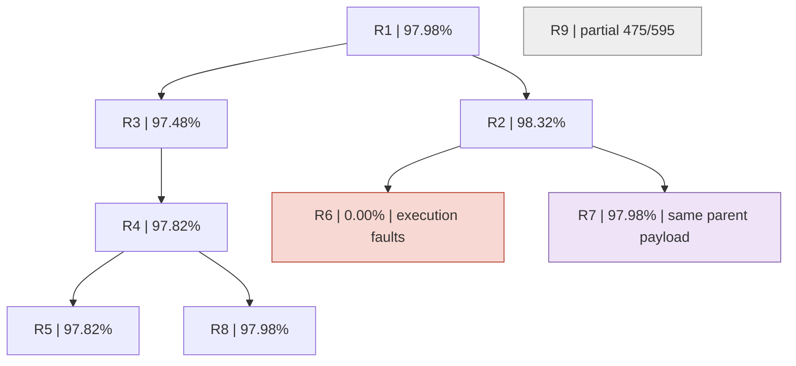

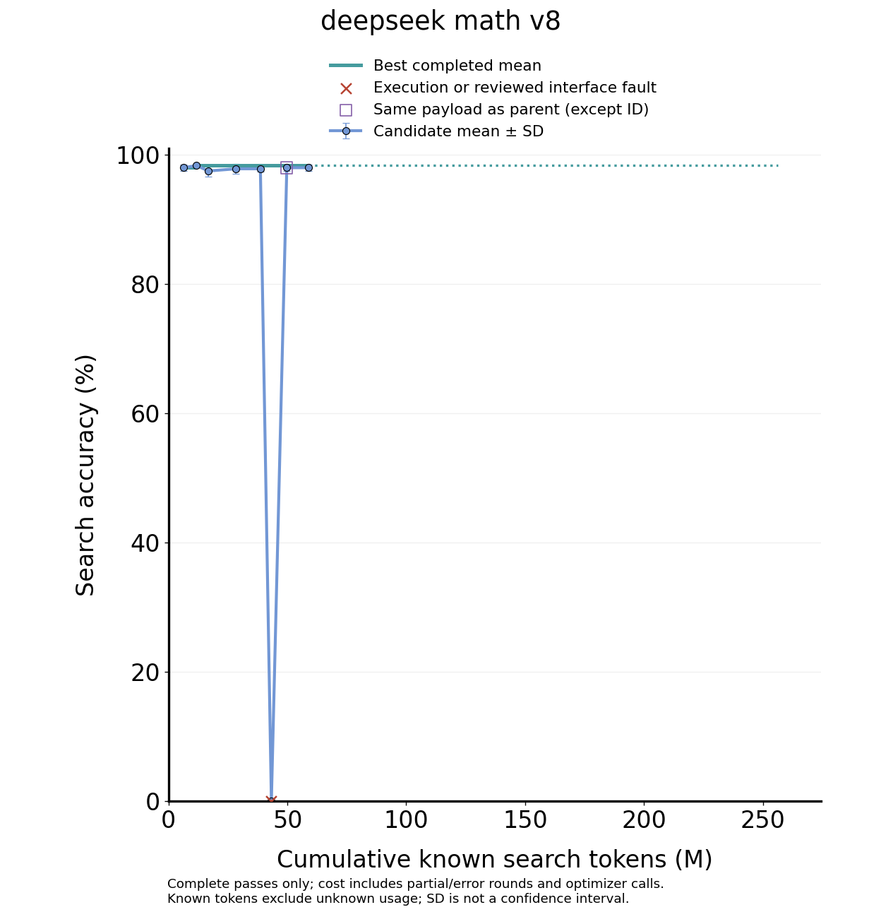

| Round ← parent | Complete search | Δ vs parent | Improved / regressed tasks | Artifact changes | Fault rows |
| --- | ---: | ---: | ---: | --- | ---: |
| R1 ← — | 97.98% | — | — / — | seed | 0 |
| R2 ← 1 | 98.32% | +0.34 pp | 1 / 0 | MAS_control, evidence_routing_declared, agent_library_or_program | 0 |
| R3 ← 1 | 97.48% | -0.50 pp | 0 / 3 | agent_library_or_program | 0 |
| R4 ← 3 | 97.82% | +0.34 pp | 4 / 2 | MAS_control, evidence_routing_declared | 0 |
| R5 ← 4 | 97.82% | -0.00 pp | 2 / 2 | MAS_control, evidence_routing_declared, agent_library_or_program | 0 |
| R6 ← 2 | 0.00% | -98.32 pp | 0 / 117 | MAS_control, spawn_or_stop_declared, evidence_routing_declared, agent_library_or_program | 595 |
| R7 ← 2 | 97.98% | -0.34 pp | 0 / 1 | identical_payload_repeat | 0 |
| R8 ← 4 | 97.98% | +0.17 pp | 1 / 0 | MAS_control, evidence_routing_declared, agent_library_or_program | 0 |
| R9 ← — | — | — | — / — | unavailable | 0 |

### deepseek_drop

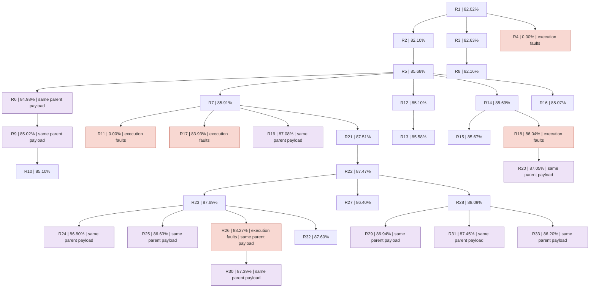

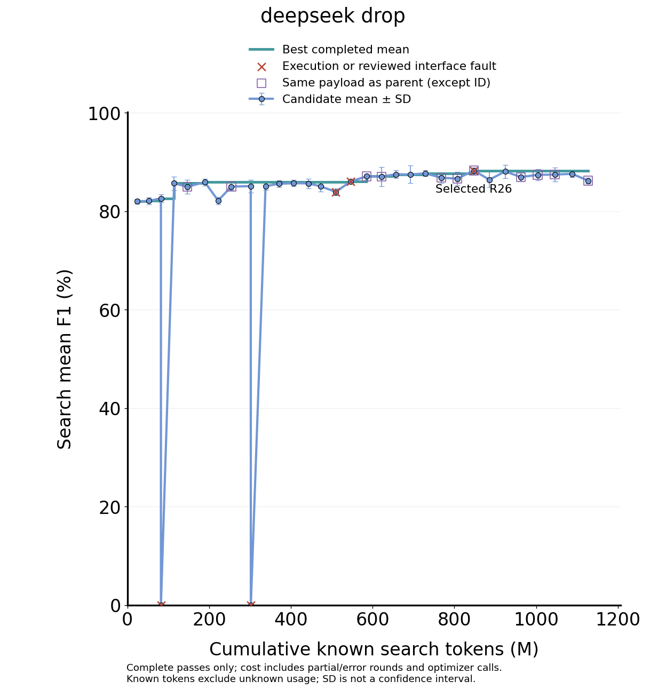

| Round ← parent | Complete search | Δ vs parent | Improved / regressed tasks | Artifact changes | Fault rows |
| --- | ---: | ---: | ---: | --- | ---: |
| R1 ← — | 82.02% | — | — / — | seed | 0 |
| R2 ← 1 | 82.10% | +0.08 pp | 18 / 20 | MAS_control, evidence_routing_declared, agent_library_or_program, profiles_or_permissions, tool_definition_or_capability | 0 |
| R3 ← 1 | 82.63% | +0.62 pp | 14 / 18 | MAS_control, spawn_or_stop_declared, agent_library_or_program, profiles_or_permissions, tool_definition_or_capability | 0 |
| R4 ← 1 | 0.00% | -82.02 pp | 0 / 185 | MAS_control, spawn_or_stop_declared, evidence_routing_declared, agent_library_or_program, profiles_or_permissions, tool_definition_or_capability, interface_repair_declared | 1000 |
| R5 ← 2 | 85.68% | +3.58 pp | 35 / 16 | agent_library_or_program, profiles_or_permissions, global_prompts | 0 |
| R6 ← 5 | 84.98% | -0.70 pp | 10 / 19 | identical_payload_repeat | 0 |
| R7 ← 5 | 85.91% | +0.23 pp | 17 / 18 | agent_library_or_program, profiles_or_permissions, global_prompts | 0 |
| R8 ← 3 | 82.16% | -0.47 pp | 20 / 20 | agent_library_or_program | 0 |
| R9 ← 6 | 85.02% | +0.04 pp | 13 / 12 | identical_payload_repeat | 0 |
| R10 ← 9 | 85.10% | +0.08 pp | 21 / 20 | agent_library_or_program, global_prompts | 0 |
| R11 ← 7 | 0.00% | -85.91 pp | 0 / 187 | MAS_control, spawn_or_stop_declared, evidence_routing_declared, agent_library_or_program | 1000 |
| R12 ← 5 | 85.10% | -0.57 pp | 17 / 17 | agent_library_or_program | 0 |
| R13 ← 12 | 85.58% | +0.48 pp | 20 / 12 | agent_library_or_program | 0 |
| R14 ← 5 | 85.69% | +0.01 pp | 18 / 15 | agent_library_or_program | 0 |
| R15 ← 14 | 85.67% | -0.02 pp | 17 / 19 | agent_library_or_program | 0 |
| R16 ← 5 | 85.07% | -0.61 pp | 17 / 17 | agent_library_or_program | 0 |
| R17 ← 7 | 83.93% | -1.98 pp | 12 / 23 | agent_library_or_program | 1 |
| R18 ← 14 | 86.04% | +0.35 pp | 16 / 15 | agent_library_or_program | 1 |
| R19 ← 7 | 87.08% | +1.18 pp | 25 / 18 | identical_payload_repeat | 0 |
| R20 ← 18 | 87.05% | +1.01 pp | 21 / 16 | identical_payload_repeat | 0 |
| R21 ← 7 | 87.51% | +1.60 pp | 22 / 12 | agent_library_or_program | 0 |
| R22 ← 21 | 87.47% | -0.03 pp | 16 / 17 | agent_library_or_program | 0 |
| R23 ← 22 | 87.69% | +0.22 pp | 20 / 13 | agent_library_or_program | 0 |
| R24 ← 23 | 86.80% | -0.89 pp | 12 / 18 | identical_payload_repeat | 0 |
| R25 ← 23 | 86.63% | -1.05 pp | 9 / 19 | identical_payload_repeat | 0 |
| R26 ← 23 | 88.27% | +0.58 pp | 14 / 14 | identical_payload_repeat | 1 |
| R27 ← 22 | 86.40% | -1.07 pp | 17 / 15 | agent_library_or_program | 0 |
| R28 ← 22 | 88.09% | +0.61 pp | 23 / 17 | agent_library_or_program | 0 |
| R29 ← 28 | 86.94% | -1.15 pp | 16 / 25 | identical_payload_repeat | 0 |
| R30 ← 26 | 87.39% | -0.88 pp | 10 / 22 | identical_payload_repeat | 0 |
| R31 ← 28 | 87.45% | -0.64 pp | 18 / 20 | identical_payload_repeat | 0 |
| R32 ← 23 | 87.60% | -0.09 pp | 17 / 15 | other_artifact_change | 0 |
| R33 ← 28 | 86.20% | -1.88 pp | 13 / 25 | identical_payload_repeat | 0 |

### deepseek_mbpp

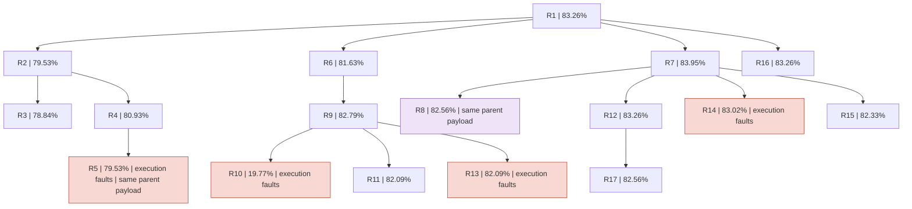

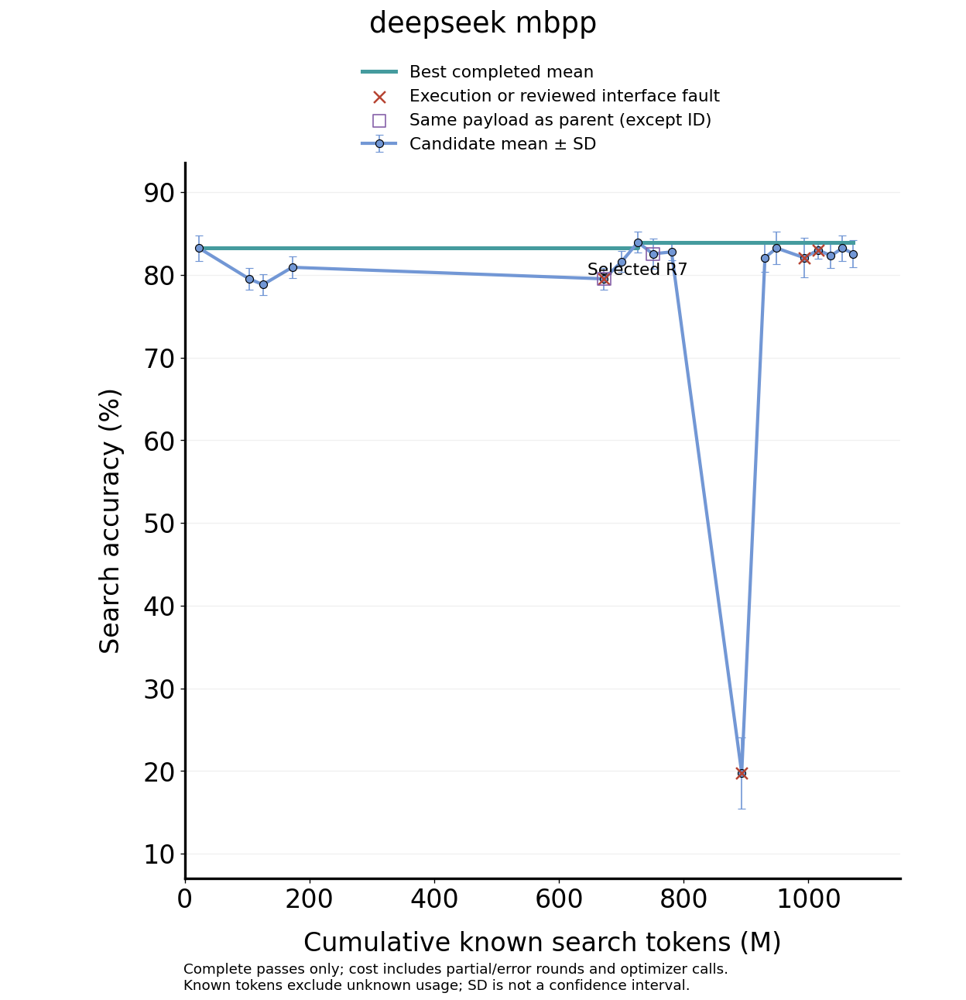

| Round ← parent | Complete search | Δ vs parent | Improved / regressed tasks | Artifact changes | Fault rows |
| --- | ---: | ---: | ---: | --- | ---: |
| R1 ← — | 83.26% | — | — / — | seed | 0 |
| R2 ← 1 | 79.53% | -3.72 pp | 3 / 7 | MAS_control, spawn_or_stop_declared, evidence_routing_declared, agent_library_or_program, tool_definition_or_capability, interface_repair_declared | 0 |
| R3 ← 2 | 78.84% | -0.70 pp | 4 / 7 | MAS_control, spawn_or_stop_declared, evidence_routing_declared, interface_repair_declared | 0 |
| R4 ← 2 | 80.93% | +1.40 pp | 6 / 3 | MAS_control, spawn_or_stop_declared, evidence_routing_declared, agent_library_or_program, global_prompts, interface_repair_declared | 0 |
| R5 ← 4 | 79.53% | -1.40 pp | 1 / 6 | identical_payload_repeat | 2 |
| R6 ← 1 | 81.63% | -1.63 pp | 5 / 9 | MAS_control, spawn_or_stop_declared, evidence_routing_declared, agent_library_or_program, tool_definition_or_capability, interface_repair_declared | 0 |
| R7 ← 1 | 83.95% | +0.70 pp | 4 / 4 | MAS_control, spawn_or_stop_declared, evidence_routing_declared, agent_library_or_program, tool_definition_or_capability, interface_repair_declared | 0 |
| R8 ← 7 | 82.56% | -1.40 pp | 4 / 6 | identical_payload_repeat | 0 |
| R9 ← 6 | 82.79% | +1.16 pp | 7 / 5 | agent_library_or_program, interface_repair_declared | 0 |
| R10 ← 9 | 19.77% | -63.02 pp | 0 / 72 | agent_library_or_program, interface_repair_declared | 330 |
| R11 ← 9 | 82.09% | -0.70 pp | 7 / 7 | agent_library_or_program, interface_repair_declared | 0 |
| R12 ← 7 | 83.26% | -0.70 pp | 6 / 8 | agent_library_or_program, profiles_or_permissions, interface_repair_declared | 0 |
| R13 ← 9 | 82.09% | -0.70 pp | 5 / 7 | agent_library_or_program, interface_repair_declared | 6 |
| R14 ← 7 | 83.02% | -0.93 pp | 6 / 10 | agent_library_or_program, interface_repair_declared | 1 |
| R15 ← 7 | 82.33% | -1.63 pp | 2 / 7 | agent_library_or_program, profiles_or_permissions, interface_repair_declared | 0 |
| R16 ← 1 | 83.26% | +0.00 pp | 4 / 5 | MAS_control, spawn_or_stop_declared, evidence_routing_declared, agent_library_or_program, profiles_or_permissions, tool_definition_or_capability, interface_repair_declared | 0 |
| R17 ← 12 | 82.56% | -0.70 pp | 5 / 7 | global_prompts, interface_repair_declared | 0 |

### deepseek_bfcl

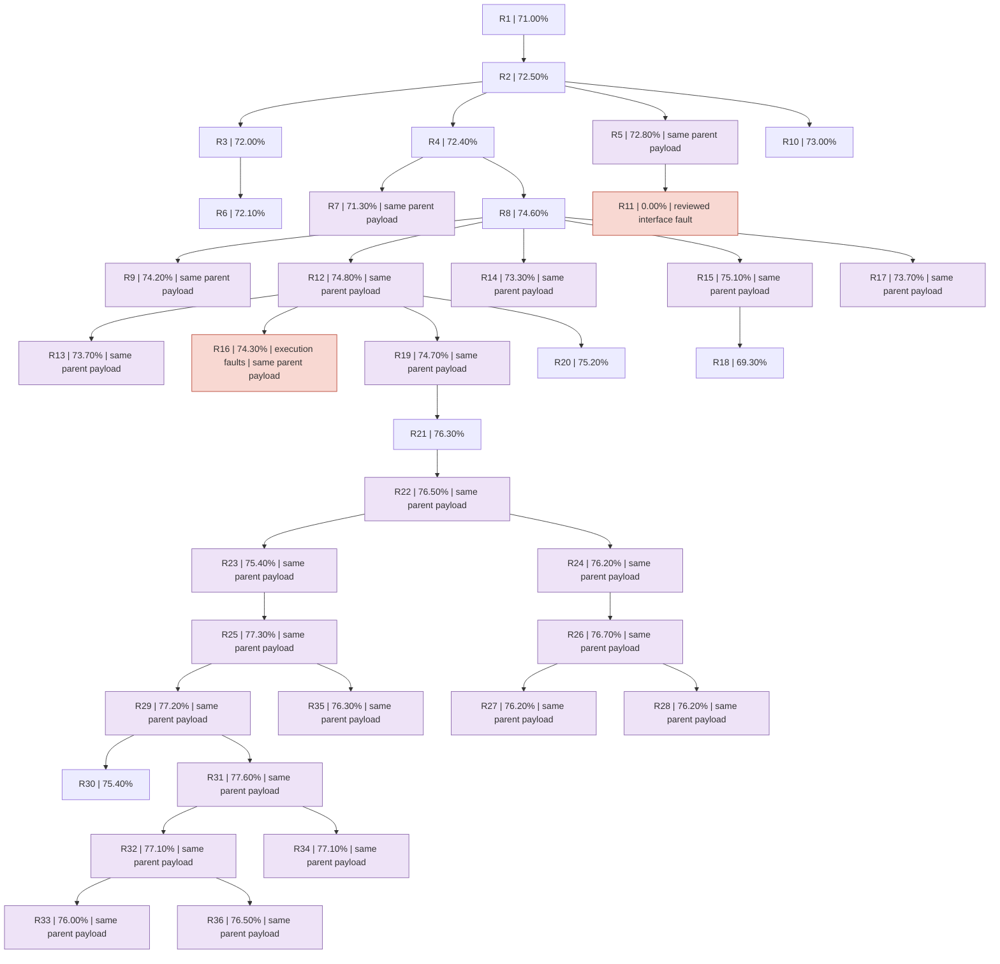

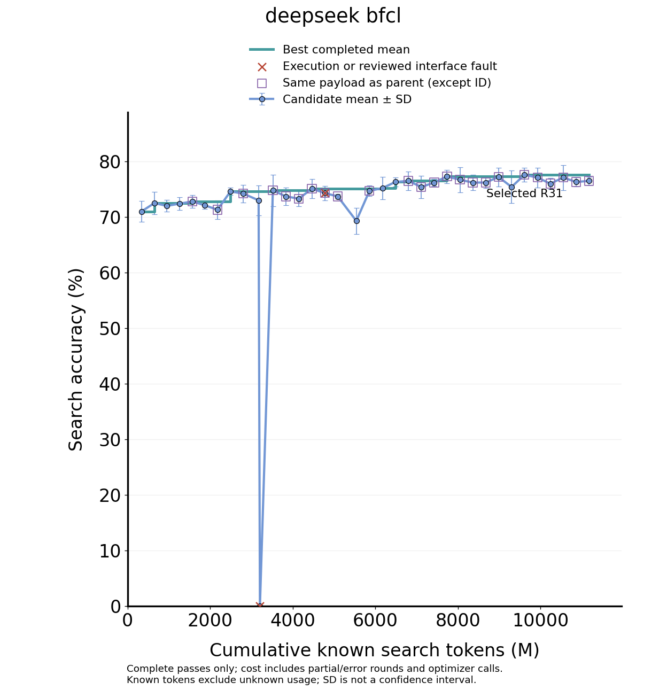

| Round ← parent | Complete search | Δ vs parent | Improved / regressed tasks | Artifact changes | Fault rows |
| --- | ---: | ---: | ---: | --- | ---: |
| R1 ← — | 71.00% | — | — / — | seed | 0 |
| R2 ← 1 | 72.50% | +1.50 pp | 38 / 22 | MAS_control, spawn_or_stop_declared, evidence_routing_declared, agent_library_or_program, profiles_or_permissions, global_prompts, tool_definition_or_capability | 0 |
| R3 ← 2 | 72.00% | -0.50 pp | 17 / 23 | profiles_or_permissions | 0 |
| R4 ← 2 | 72.40% | -0.10 pp | 17 / 18 | agent_library_or_program | 0 |
| R5 ← 2 | 72.80% | +0.30 pp | 14 / 15 | identical_payload_repeat | 0 |
| R6 ← 3 | 72.10% | +0.10 pp | 16 / 15 | other_artifact_change | 0 |
| R7 ← 4 | 71.30% | -1.10 pp | 15 / 15 | identical_payload_repeat | 0 |
| R8 ← 4 | 74.60% | +2.20 pp | 23 / 17 | MAS_control, spawn_or_stop_declared, evidence_routing_declared, agent_library_or_program, profiles_or_permissions | 0 |
| R9 ← 8 | 74.20% | -0.40 pp | 18 / 19 | identical_payload_repeat | 0 |
| R10 ← 2 | 73.00% | +0.50 pp | 24 / 20 | agent_library_or_program, profiles_or_permissions | 0 |
| R11 ← 5 | 0.00% | -72.80 pp | 0 / 162 | agent_library_or_program, profiles_or_permissions | 0 + reviewed interface fault |
| R12 ← 8 | 74.80% | +0.20 pp | 20 / 15 | identical_payload_repeat | 0 |
| R13 ← 12 | 73.70% | -1.10 pp | 15 / 21 | identical_payload_repeat | 0 |
| R14 ← 8 | 73.30% | -1.30 pp | 13 / 22 | identical_payload_repeat | 0 |
| R15 ← 8 | 75.10% | +0.50 pp | 19 / 13 | identical_payload_repeat | 0 |
| R16 ← 12 | 74.30% | -0.50 pp | 16 / 22 | identical_payload_repeat | 1 |
| R17 ← 8 | 73.70% | -0.90 pp | 16 / 23 | identical_payload_repeat | 0 |
| R18 ← 15 | 69.30% | -5.80 pp | 18 / 36 | agent_library_or_program, profiles_or_permissions | 0 |
| R19 ← 12 | 74.70% | -0.10 pp | 18 / 18 | identical_payload_repeat | 0 |
| R20 ← 12 | 75.20% | +0.40 pp | 20 / 17 | global_prompts | 0 |
| R21 ← 19 | 76.30% | +1.60 pp | 23 / 18 | profiles_or_permissions, global_prompts | 0 |
| R22 ← 21 | 76.50% | +0.20 pp | 21 / 22 | identical_payload_repeat | 0 |
| R23 ← 22 | 75.40% | -1.10 pp | 17 / 28 | identical_payload_repeat | 0 |
| R24 ← 22 | 76.20% | -0.30 pp | 23 / 20 | identical_payload_repeat | 0 |
| R25 ← 23 | 77.30% | +1.90 pp | 26 / 9 | identical_payload_repeat | 0 |
| R26 ← 24 | 76.70% | +0.50 pp | 21 / 18 | identical_payload_repeat | 0 |
| R27 ← 26 | 76.20% | -0.50 pp | 21 / 21 | identical_payload_repeat | 0 |
| R28 ← 26 | 76.20% | -0.50 pp | 16 / 18 | identical_payload_repeat | 0 |
| R29 ← 25 | 77.20% | -0.10 pp | 17 / 18 | identical_payload_repeat | 0 |
| R30 ← 29 | 75.40% | -1.80 pp | 15 / 28 | global_prompts | 0 |
| R31 ← 29 | 77.60% | +0.40 pp | 18 / 16 | identical_payload_repeat | 0 |
| R32 ← 31 | 77.10% | -0.50 pp | 13 / 14 | identical_payload_repeat | 0 |
| R33 ← 32 | 76.00% | -1.10 pp | 12 / 20 | identical_payload_repeat | 0 |
| R34 ← 31 | 77.10% | -0.50 pp | 17 / 19 | identical_payload_repeat | 0 |
| R35 ← 25 | 76.30% | -1.00 pp | 16 / 22 | identical_payload_repeat | 0 |
| R36 ← 32 | 76.50% | -0.60 pp | 14 / 22 | identical_payload_repeat | 0 |

### deepseek_automation_v5

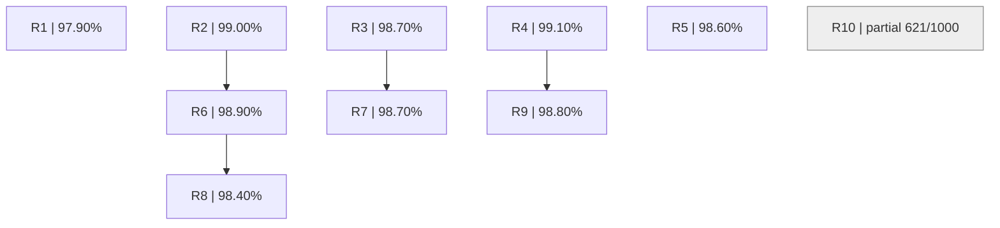

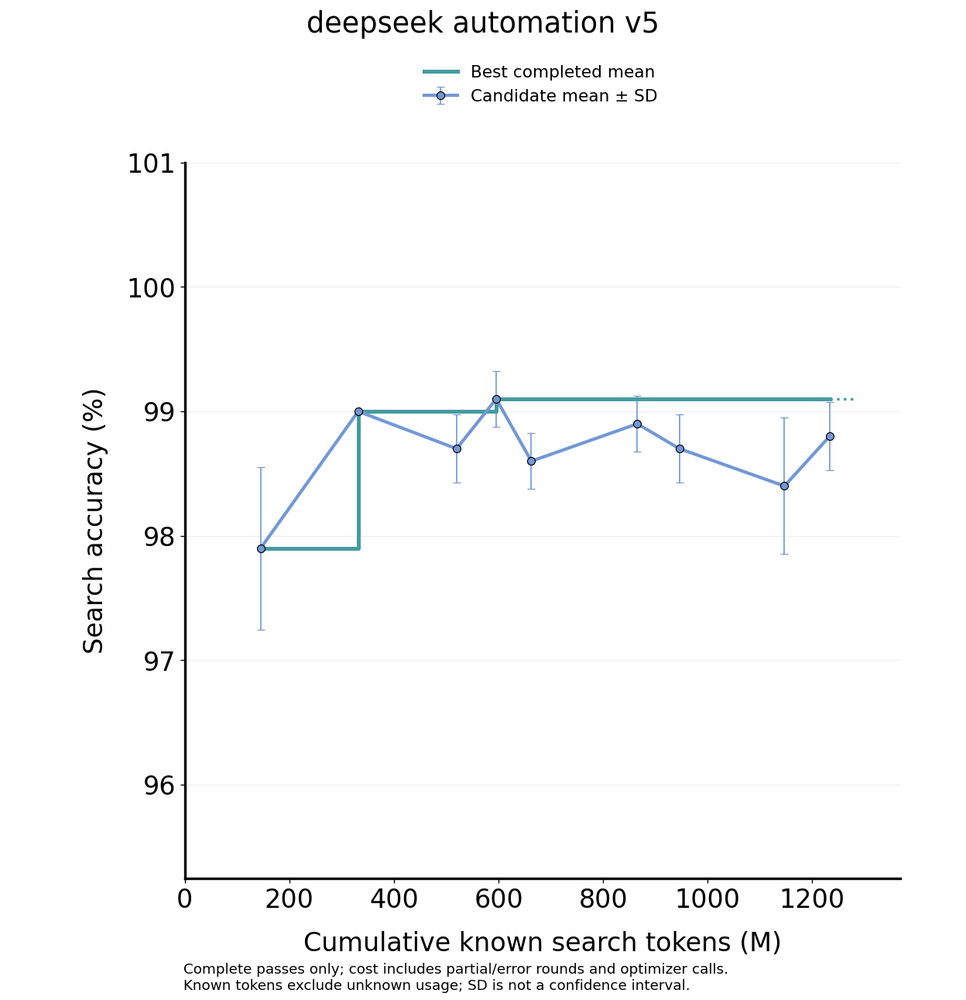

| Round ← parent | Complete search | Δ vs parent | Improved / regressed tasks | Artifact changes | Fault rows |
| --- | ---: | ---: | ---: | --- | ---: |
| R1 ← — | 97.90% | — | — / — | seed | 0 |
| R2 ← — | 99.00% | — | — / — | unavailable | 0 |
| R3 ← — | 98.70% | — | — / — | unavailable | 0 |
| R4 ← — | 99.10% | — | — / — | unavailable | 0 |
| R5 ← — | 98.60% | — | — / — | unavailable | 0 |
| R6 ← 2 | 98.90% | -0.10 pp | 1 / 2 | MAS_control, spawn_or_stop_declared, evidence_routing_declared, agent_library_or_program | 0 |
| R7 ← 3 | 98.70% | -0.00 pp | 2 / 2 | MAS_control, evidence_routing_declared, agent_library_or_program | 0 |
| R8 ← 6 | 98.40% | -0.50 pp | 0 / 4 | MAS_control, spawn_or_stop_declared | 0 |
| R9 ← 4 | 98.80% | -0.30 pp | 0 / 2 | agent_library_or_program | 0 |
| R10 ← — | — | — | — / — | unavailable | 0 |

### deepseek_automation_v6

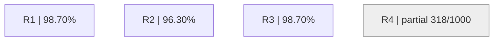

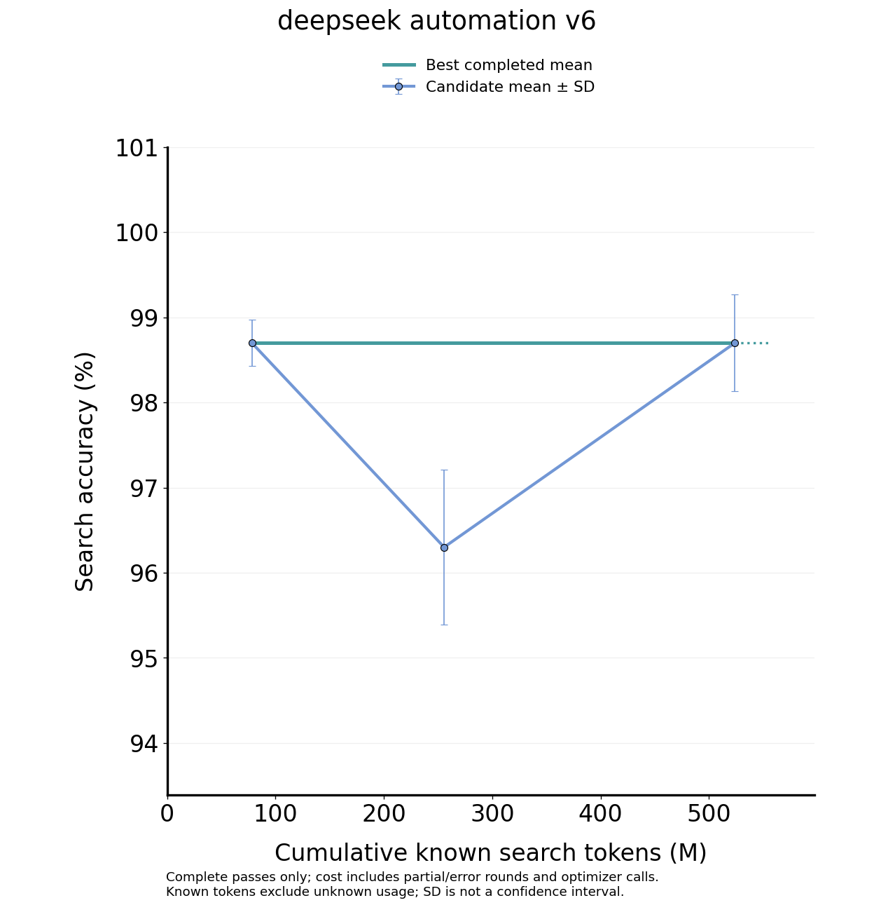

| Round ← parent | Complete search | Δ vs parent | Improved / regressed tasks | Artifact changes | Fault rows |
| --- | ---: | ---: | ---: | --- | ---: |
| R1 ← — | 98.70% | — | — / — | seed | 0 |
| R2 ← — | 96.30% | — | — / — | unavailable | 0 |
| R3 ← — | 98.70% | — | — / — | unavailable | 0 |
| R4 ← — | — | — | — / — | unavailable | 0 |

### deepseek_automation_v7

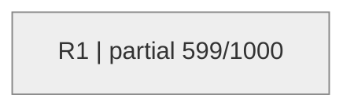

| Round ← parent | Complete search | Δ vs parent | Improved / regressed tasks | Artifact changes | Fault rows |
| --- | ---: | ---: | ---: | --- | ---: |
| R1 ← — | — | — | — / — | seed | 0 |

### deepseek_automation_v8

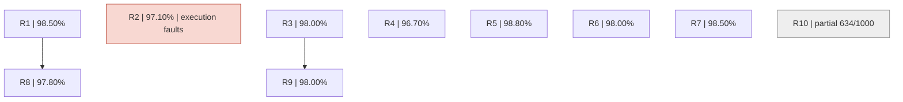

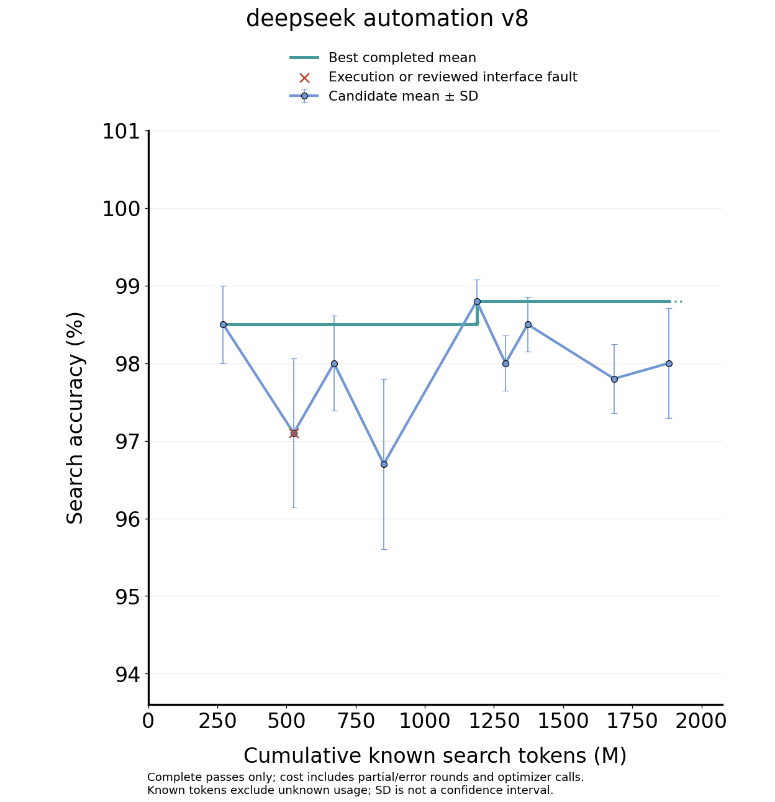

| Round ← parent | Complete search | Δ vs parent | Improved / regressed tasks | Artifact changes | Fault rows |
| --- | ---: | ---: | ---: | --- | ---: |
| R1 ← — | 98.50% | — | — / — | seed | 0 |
| R2 ← — | 97.10% | — | — / — | unavailable | 11 |
| R3 ← — | 98.00% | — | — / — | unavailable | 0 |
| R4 ← — | 96.70% | — | — / — | unavailable | 0 |
| R5 ← — | 98.80% | — | — / — | unavailable | 0 |
| R6 ← — | 98.00% | — | — / — | unavailable | 0 |
| R7 ← — | 98.50% | — | — / — | unavailable | 0 |
| R8 ← 1 | 97.80% | -0.70 pp | 2 / 8 | MAS_control, spawn_or_stop_declared, evidence_routing_declared, agent_library_or_program | 0 |
| R9 ← 3 | 98.00% | +0.00 pp | 5 / 5 | MAS_control, evidence_routing_declared, agent_library_or_program, profiles_or_permissions | 0 |
| R10 ← — | — | — | — / — | unavailable | 0 |

### deepseek_automation_v9

| Round ← parent | Complete search | Δ vs parent | Improved / regressed tasks | Artifact changes | Fault rows |
| --- | ---: | ---: | ---: | --- | ---: |
| R1 ← — | — | — | — / — | seed | 0 |

### deepseek_automation_v10

| Round ← parent | Complete search | Δ vs parent | Improved / regressed tasks | Artifact changes | Fault rows |
| --- | ---: | ---: | ---: | --- | ---: |
| R1 ← — | — | — | — / — | seed | 0 |

### deepseek_automation_v11

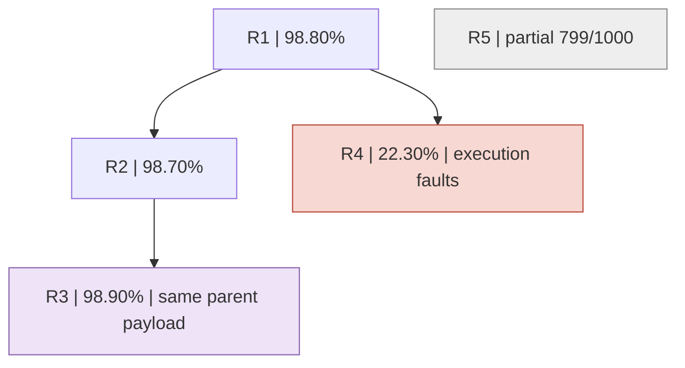

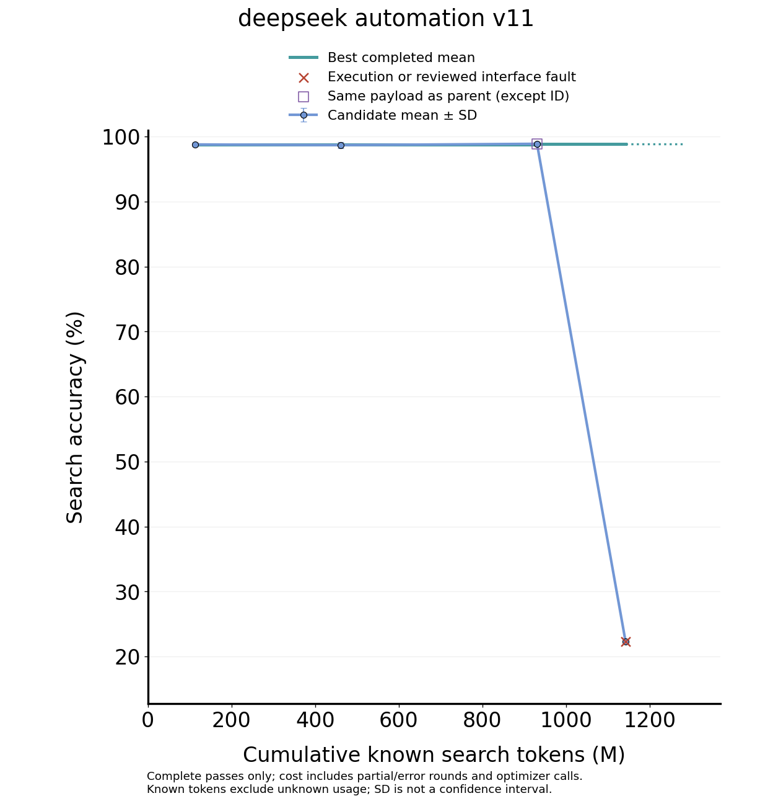

| Round ← parent | Complete search | Δ vs parent | Improved / regressed tasks | Artifact changes | Fault rows |
| --- | ---: | ---: | ---: | --- | ---: |
| R1 ← — | 98.80% | — | — / — | seed | 0 |
| R2 ← 1 | 98.70% | -0.10 pp | 1 / 1 | MAS_control, spawn_or_stop_declared, evidence_routing_declared, agent_library_or_program, tool_definition_or_capability | 0 |
| R3 ← 2 | 98.90% | +0.20 pp | 2 / 0 | identical_payload_repeat | 0 |
| R4 ← 1 | 22.30% | -76.50 pp | 1 / 154 | MAS_control, spawn_or_stop_declared, evidence_routing_declared, agent_library_or_program, tool_definition_or_capability, interface_repair_declared | 776 |
| R5 ← — | — | — | — / — | unavailable | 0 |

### deepseek_hle

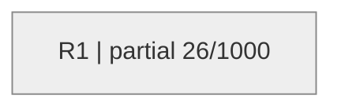

| Round ← parent | Complete search | Δ vs parent | Improved / regressed tasks | Artifact changes | Fault rows |
| --- | ---: | ---: | ---: | --- | ---: |
| R1 ← — | — | — | — / — | seed | 0 |

### deepseek_mbpp_previous

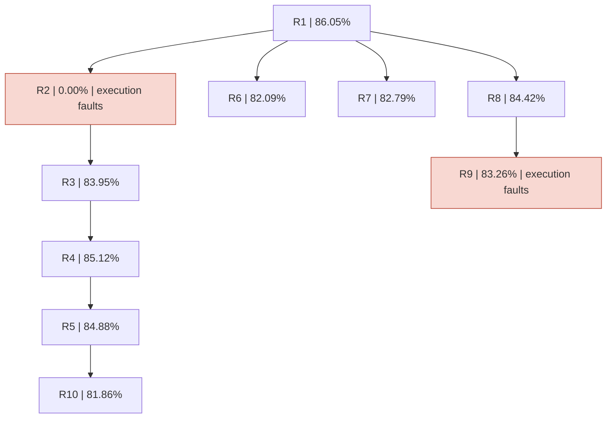

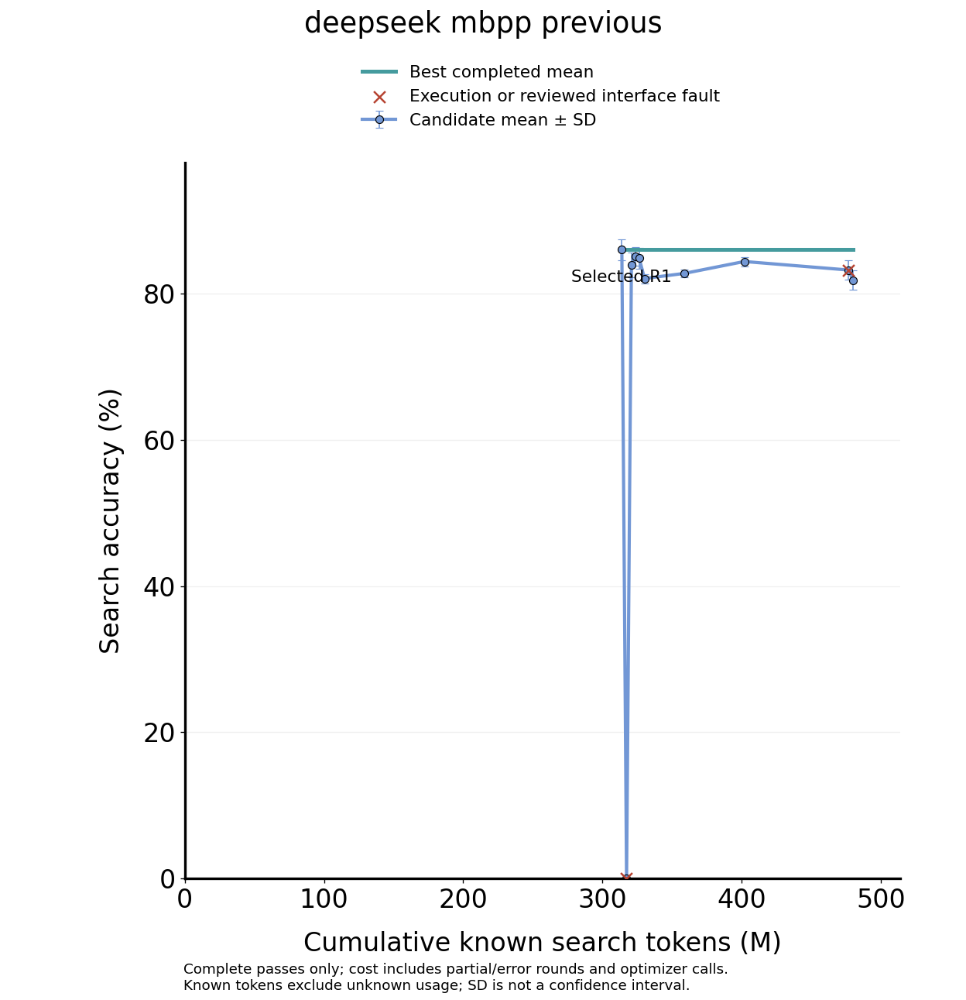

| Round ← parent | Complete search | Δ vs parent | Improved / regressed tasks | Artifact changes | Fault rows |
| --- | ---: | ---: | ---: | --- | ---: |
| R1 ← — | 86.05% | — | — / — | seed | 0 |
| R2 ← 1 | 0.00% | -86.05 pp | 0 / 77 | MAS_control, spawn_or_stop_declared, evidence_routing_declared, agent_library_or_program, profiles_or_permissions, tool_definition_or_capability | 430 |
| R3 ← 2 | 83.95% | +83.95 pp | 74 / 0 | MAS_control, evidence_routing_declared, agent_library_or_program, profiles_or_permissions, interface_repair_declared | 0 |
| R4 ← 3 | 85.12% | +1.16 pp | 5 / 2 | MAS_control, spawn_or_stop_declared, evidence_routing_declared, agent_library_or_program, interface_repair_declared | 0 |
| R5 ← 4 | 84.88% | -0.23 pp | 3 / 3 | MAS_control, spawn_or_stop_declared, evidence_routing_declared, agent_library_or_program, interface_repair_declared | 0 |
| R6 ← 1 | 82.09% | -3.95 pp | 3 / 12 | MAS_control, spawn_or_stop_declared, evidence_routing_declared, agent_library_or_program, profiles_or_permissions, tool_definition_or_capability | 0 |
| R7 ← 1 | 82.79% | -3.26 pp | 1 / 8 | MAS_control, spawn_or_stop_declared, evidence_routing_declared, agent_library_or_program, profiles_or_permissions, tool_definition_or_capability, interface_repair_declared | 0 |
| R8 ← 1 | 84.42% | -1.63 pp | 5 / 6 | MAS_control, spawn_or_stop_declared, evidence_routing_declared, agent_library_or_program | 0 |
| R9 ← 8 | 83.26% | -1.16 pp | 4 / 9 | agent_library_or_program, interface_repair_declared | 1 |
| R10 ← 5 | 81.86% | -3.02 pp | 4 / 11 | MAS_control, spawn_or_stop_declared, evidence_routing_declared, agent_library_or_program | 0 |

### qwen_math

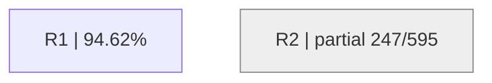

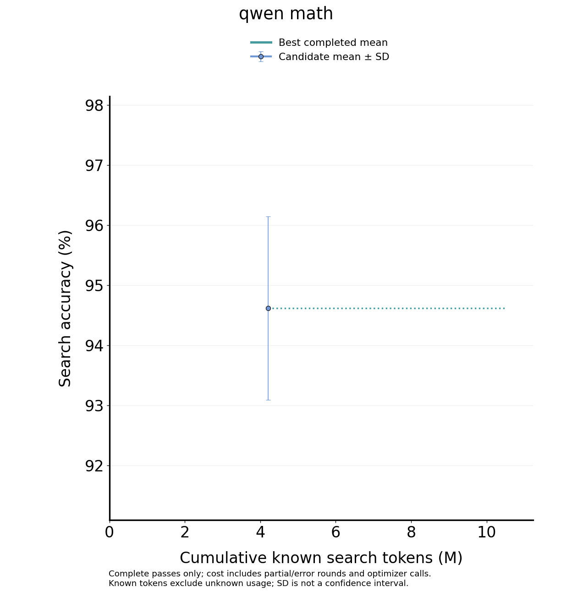

| Round ← parent | Complete search | Δ vs parent | Improved / regressed tasks | Artifact changes | Fault rows |
| --- | ---: | ---: | ---: | --- | ---: |
| R1 ← — | 94.62% | — | — / — | seed | 0 |
| R2 ← — | — | — | — / — | seed | 0 |

## Reproduction and files

`scripts/audit_mechanisms.py --spec <private-run-paths.json> --out <private-audit.json>` reads frozen search/test records. The spec is a list of `id`, `benchmark`, `model`, `role`, `count` (search tasks), `repeats`, `search` directory, and named `tests` directories. `--spec-json` supports remote read-only collection over SSH. It does not import agents or providers.

`uv run --with matplotlib python scripts/render_mechanism_audit.py --input <local.json> <remote.json> --out <report-directory>` creates this aggregate report. Private source paths, prompts, reference answers, model responses, and optimizer descriptions are not exported.

`node scripts/verify_audit_identities.mjs <private-run-paths.json> > <identities.json>` verifies frozen candidates against retained pass manifests using the application digest (requires the built application). Supply `--identities <identities.json>` to the renderer to include this cross-check.

Supply `--reviewed-faults <report-directory>/reviewed-faults.json` to reproduce the manually reviewed engineering-fault annotations. These annotations do not rewrite task outcomes.

- `rounds.csv`: actual parents, score changes, artifact component changes, faults, and known cumulative tokens.
- `search-mechanisms.csv`: full and partial round execution counts with coverage denominators.
- `test-mechanisms.csv`: realized mechanisms for each available test/ablation.
- `category-associations.csv`: clean complete parent-child comparisons, multi-label and observational.
- `category-summary.csv`: aggregate associations; identity-only repeats are explicitly separate from changes.
- `candidate-identities.csv` and `manifest-verification.csv`: repeat counts and executed candidate checks.
- `figures/`: Mermaid tree sources and PNG/SVG/PDF curves.

Plot provenance: adapted from data-viz Figure 04. Its palette, main axes proportions, and line/errorbar encoding are retained; biological phase shading, insets, demo data, and significance annotations are removed. Score uncertainty is repeated-pass SD, not confidence intervals or independent-task replication.
