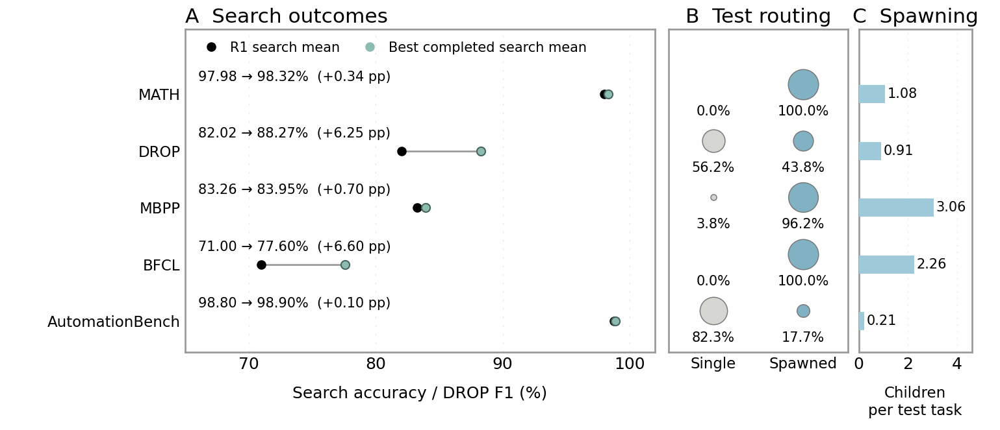
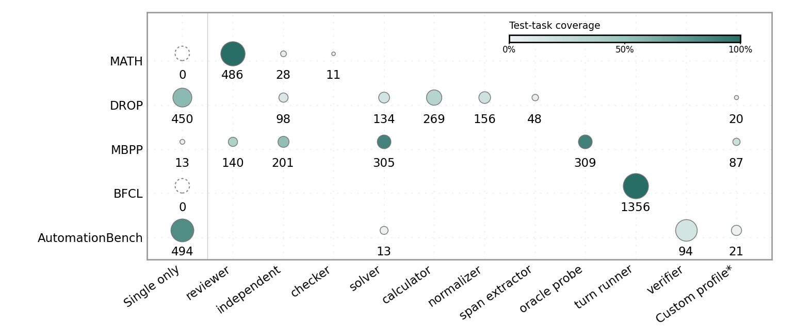
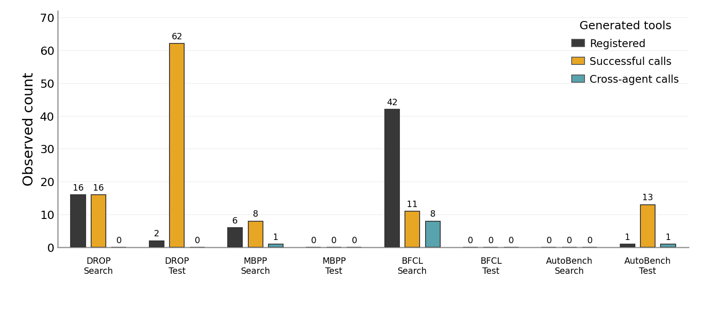

# MFlow mechanism evidence: visual summary

These figures summarize the existing 2026-10-12 audit. No model requests or new evaluations were made. They show observed search outcomes, adaptive spawning, member choices, and working tool creation/reuse. The [full audit](../README.md) retains all indexed lineages and fixed-MAS variants.

The compact figures omit figure-wide titles and place panel titles close to their borders. They use benchmark-only row labels, separated and centered bubble/count labels, and in-panel legends. Explanatory captions are provided below rather than embedded in the images. The underlying CSV values are unchanged.

## 1. Search outcomes and adaptive execution



[SVG](01-search-and-adaptation.svg) · [PDF](01-search-and-adaptation.pdf) · [Data](overview.csv)

- Left: R1 and best completed five-pass search means. DROP uses F1; the other benchmarks use accuracy. These are observed outcomes, not isolated causal estimates of each structure edit.
- Center: percentage of full test tasks that remain single versus have at least one SPAWN event. The two percentages sum to 100%. Bubble area represents the percentage.
- Right: total SPAWN events divided by **all** test tasks, including tasks that stay single.
- MATH uses R2, DROP R26, MBPP R7, BFCL supplementary R29, and AutomationBench v11 supplementary R3 test sets. BFCL's best search mean belongs to R31; the R29 and R31 strategy payloads are identical apart from round ID.

## 2. Observed member choices



[SVG](02-spawned-members.svg) · [PDF](02-spawned-members.pdf) · [Spawn counts](members.csv) · [Task coverage](member-task-coverage.csv)

The leading **Single only** column counts test tasks with no SPAWN events: MATH 0/486, DROP 450/800, MBPP 13/341, BFCL 0/600, and AutomationBench 494/600. Its bubble area and color represent the fraction of all test tasks; the number is the task count. These counts include both correct and incorrect answers. The values come from [overview.csv](overview.csv).

Dashed hollow circles in the Single only column mark zero tasks; their fixed size is a visibility marker, not a quantitative area.

The remaining member columns overlay three measures without adding panels or increasing the canvas:

- **Area:** the member category's fraction of all spawn events within that benchmark.
- **Color:** the percentage of all test tasks in which that member category is spawned at least once. Repeated spawns within a task count once for this measure. Darker colors indicate broader task coverage.
- **Number:** total SPAWN events, including repeated spawns within the same task.

Blank cells mean no observed events for that role. These measures describe member selection, not successful completion of each spawned agent.

The coverage layer comes from a fresh offline pass over the same frozen test lifecycle traces. It is matched to the original event totals and task counts before rendering. For example, BFCL's `turn_runner` occurs in all 600 tasks but is spawned 1,356 times. AutomationBench's `verifier` accounts for 94/128 (73.44%) spawn events while appearing in only 94/600 (15.67%) test tasks. MBPP's `oracle_probe` appears in 303/341 (88.86%) tasks, with 309 spawn events. The added color layer distinguishes broad use across tasks from concentration within the subset of tasks that spawn agents.

`Custom profile` means an event without a template ID. DROP, MBPP, and AutomationBench respectively have 20, 87, and 21 such events. This is evidence of spawning outside a named template; it does not alone identify a new internal graph. Template IDs describe member identities, not a guarantee of identical reasoning on every execution.

## 3. Generated-tool execution and reuse



[SVG](03-generated-tools.svg) · [PDF](03-generated-tools.pdf) · [Data and coverage](tools.csv)

Only autonomously generated tools are counted. Ordinary Python/arithmetic tools and benchmark-provided tools are excluded.

- `Registered`: generated-tool registration records.
- `Successful calls`: recorded successful calls to generated tools.
- `Cross-agent calls`: successful calls by an agent other than the creator; a subset of successful calls.

Search counts sum all retained task × pass observations in the named current lineage, including partial rounds. Test counts cover the chosen full test set. Their exposure differs, so raw counts show observed use and are **not** stage-comparable rates or success probabilities. Registrations are not globally deduplicated across tasks/passes.

| Search lineage | All outcome episodes | Episodes with registry / usage evidence |
| --- | ---: | ---: |
| DROP | 33,000 | 30,999 / 30,999 |
| MBPP | 7,310 | 7,309 / 7,309 |
| BFCL | 36,000 | 35,999 / 35,999 |
| AutomationBench v11 | 4,799 | 4,799 / 4,799 |

All four displayed test variants have tool registry and usage coverage for every test task. Missing search traces are not filled with zero; the bars sum the available evidence. MATH's legacy generated-tool fields are unknown and omitted from this panel.

## Incomplete and historical runs

HLE has no completed search round or full test in the audited records. Remote Qwen/MATH has one complete search round (94.62% accuracy) and an incomplete R2, with no full test. Neither receives an invented full-run comparison. Their existing records, previous MBPP search, historical AutomationBench versions, and fixed homogeneous/heterogeneous variants remain in the full audit.

## Reproduction and schema

From the repository root:

```bash
uv run --no-project --with matplotlib python scripts/visualize_mechanism_evidence.py
```

The script reads only the public aggregate `rounds.csv`, `search-mechanisms.csv`, and `test-mechanisms.csv` in the parent directory. `--source <audit-directory>` supports another audit with the same lineage/variant keys. No private experiment paths are required.

The member figure additionally reads the included `member-task-coverage.csv`. Add `--members-only` to update just that figure. To refresh coverage from original private traces, use `--members-only --run-spec <private-run-paths.json>`; the spec has the same format as the audit script. This optional operation exports aggregate counts only, without task IDs, questions, answers, or trace text.

- `overview.csv`: selected test variant, search scores in percent, task counts, routing percentages, spawn-event count, and mean spawn events per task.
- `members.csv`: benchmark, frozen test round, member/template label, spawn-event count, and within-benchmark share in percent.
- `member-task-coverage.csv`: benchmark, member/template label, full test-task count, number and percentage of tasks with that member, and the matching spawn-event count.
- `tools.csv`: benchmark/stage, all observed episodes, registry and usage coverage, and the three generated-tool counts. Empty counts mean unknown.

All figures are exported as PNG, SVG, and PDF. No simulated observations, significance tests, or fabricated error bars are added.

### Template provenance

Adapted from the data-viz skill's **Figure 19** (`plot.py`: paired endpoints, aligned bubble matrix and horizontal bars) and **Figure 07** (`plot.py` and `vizlib/common.py:grouped_bars`). The original code was copied into a private preparation workspace before adaptation. The script retains the horizontal panel order, muted blue/green palette, area encoding, and grouped-bar palette. Legends are moved inside the panels at the user's request.

Figure 19's height is reduced for five benchmarks instead of 36 rows. The member matrix reclaims unused auxiliary-panel space and uses the template's color-plus-area encoding for task coverage and event share, with an in-panel color key. Its canvas is 1026 × 426 layout pixels; 35° x-axis labels reduce bottom whitespace while preserving the plotting area and font size. Figure 07 reclaims the external legend space and removes unmeasured replicate dots, error bars, P-values, and biological labels. Explanatory notes live in this document; shorter canvases reduce whitespace. Axis values, legends, and labels describe actual MFlow measures. The installed templates are unchanged.
